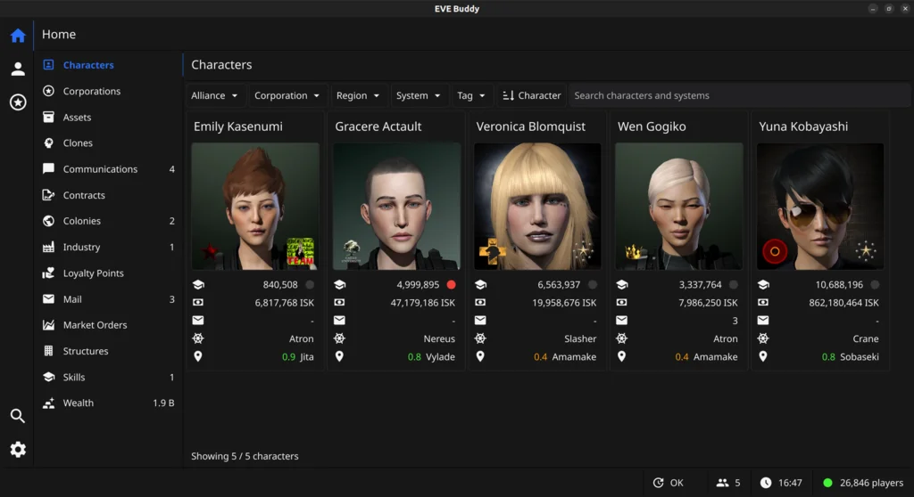
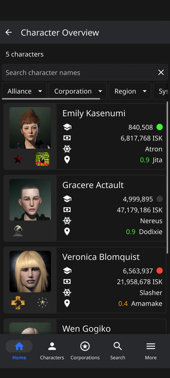

---
search:
  exclude: true

title: EVE Buddy
type: service
description: EVE Buddy is a free and open source companion app for EVE Online players, available on Windows, Linux, macOS and Android.
maintainer:
  name: Erik Kalkoken
  github: ErikKalkoken
---

#  EVE Buddy

A multi-platform companion app for EVE Online players. Free and open source. Available on Windows, Linux, macOS and Android.

- [:octicons-browser-16: __Website__](https://evebuddy.kalkoken.net){ .esi-card-link }
- [:octicons-mark-github-16: __GitHub__](https://github.com/ErikKalkoken/evebuddy){ .esi-card-link }
- [:simple-discord: __Discord__](https://discord.gg/tVSCQEVJnJ){ .esi-card-link }

## Features

- __Consolidated views__: All your characters and corporations in one view per topic, with answers the game can't give you at a glance – assets, colonies, industry jobs and more
- __Character monitor__: Keep track of each character – training queue, assets, clones, wallet and more
- __Corporation monitor__: Keep your corporation running – structures, wallets, industry jobs and members
- __Notifications__: Get notified about structure attacks, new mail, empty training queues and more
- __New Eden search__: Search live on the game server for characters, corporations, systems, types and more
- __Information windows__: Details for most objects on screen, just like the in-game information windows
- __Mail client__: Full mail client for all your characters
- __Automatic updates__: Data for all your characters and corporations is updated automatically in the background
- __Run in background__: Keeps running and notifying you while you do something else, like playing EVE. Desktop only

See the [website](https://evebuddy.kalkoken.net) for all features, install guides and support.

## Screenshots

Desktop version (Linux GNOME 42)

Mobile version (Android 17)

