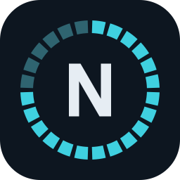
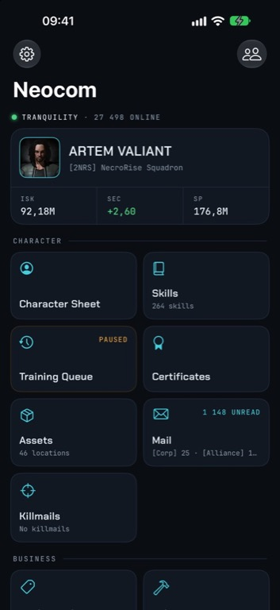
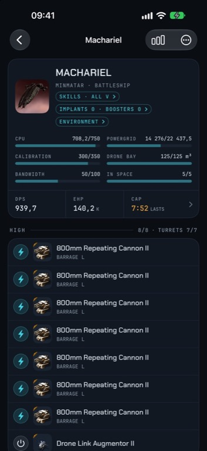
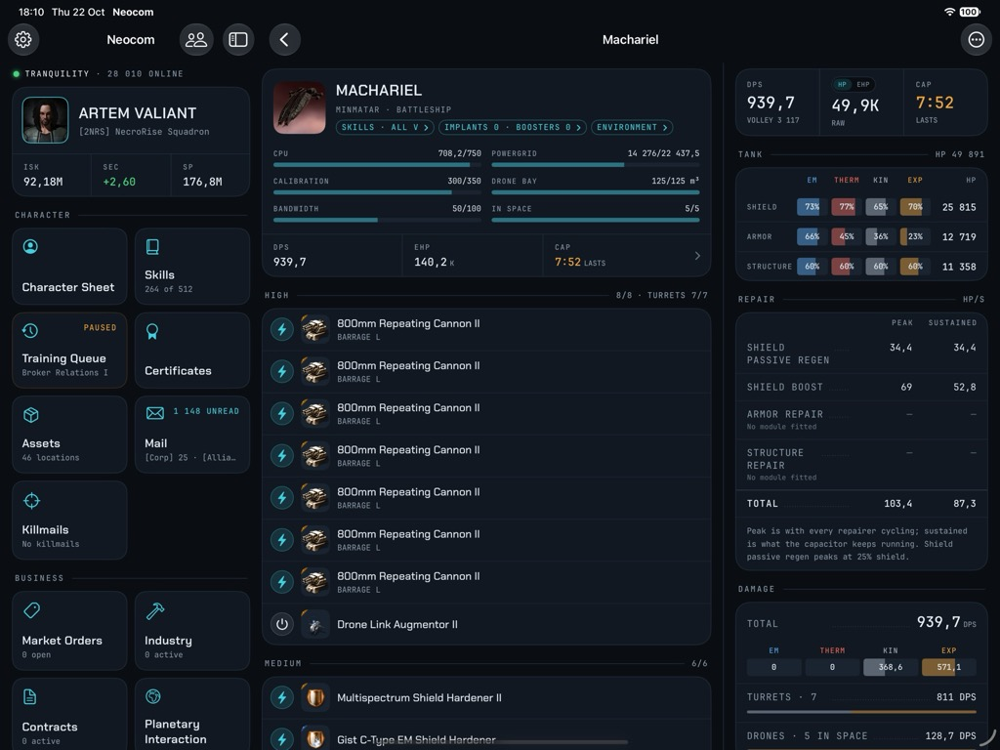

---
search:
  exclude: true

title: Neocom
type: service
description: Open-source EVE Online companion app for iPhone, iPad and Mac - skills, fittings, market, industry, mail and more.
maintainer:
  name: Artem Shimanski
  github: artem-shimanski
---

# Neocom

{ width="128" }

Neocom is an open-source EVE Online companion app for iPhone, iPad and Mac (Mac Catalyst), written in SwiftUI.
It signs in through EVE SSO, supports several characters at once, and keeps the full static data export on the device, so the item database works offline.

- [:octicons-browser-16: **Website**](https://getneocom.com){ .esi-card-link }
- [:simple-github: **GitHub**](https://github.com/artem-shimanski/Neocom){ .esi-card-link }

## Features

- **Pilot** - character sheet (attributes, implants, jump clones, wallet, location, ship), skills overview, the skill queue with a local training plan, certificates and ship mastery.
- **Fitting** - a fitting editor with DPS, EHP, capacitor and resistances calculated for the skills and implants of any signed-in pilot, fleets, fits synced through iCloud, and the character's in-game fits.
- **Market and business** - market browser with prices and history, market orders, industry jobs, contracts, assets.
- **Social** - mail (read, organize, compose), killmails, zKillboard.
- **World** - planetary interaction (colonies, extractors, factories, storage), server status.
- **Database** - the static data export browsable offline, searchable in eight languages.
- **Widgets** - skill queue widgets for the Home and Lock Screen, and training notifications.

{ width="300" }
{ width="300" }

